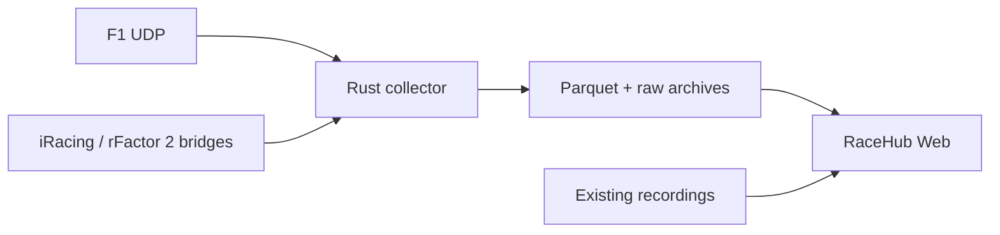

# RaceHub - open source racing telemetry

RaceHub is a free, open source application for racing telemetry analysis.
Record a session, inspect the recorded channels, and compare your laps.
Use F1, iRacing, and rFactor 2 recordings in one local application.

The local app needs no RaceHub account, subscription, or paid cloud service.
You can run it on your computer or on your own private server.
The games and their SDKs keep their own account, purchase, and licence requirements.
Read [Licence and contribution](#licence-and-contribution) for the source licence scope.

Read the [project wiki](docs/wiki/Home.md) for the module map, architecture, capture and recovery, analysis workflow, units, and validation evidence.
See [Professional analysis](docs/wiki/Professional-Analysis.md) for the tools that support detailed driver and engineering review.

- [Use the hosted analyser](#use-the-hosted-analyser)
- [Quick start](#quick-start)
- [Enable full-rate Parquet recording](#enable-full-rate-parquet-recording)
- [Connect a simulator](#connect-a-simulator)
- [Analyse a session](#analyse-a-session)
- [Files, storage, and recovery](#files-storage-and-recovery)
- [Configuration and self-hosting](#configuration-and-self-hosting)
- [Troubleshooting](#troubleshooting)
- [Development and current validation](#development-and-current-validation)
- [Licence and contribution](#licence-and-contribution)

## What you can do

- Record the player car or all available drivers.
- Keep source-rate telemetry in Parquet through the native Rust collector.
- Import existing RaceHub files, including legacy Python F1 `.pq` recordings.
- Select laps and a reference lap. Compare speed, pedals, steering, gear, RPM, fuel, tyres, and other recorded numeric channels.
- Inspect lap delta over the actual shared distance. Select a section to inspect it in all charts.
- Follow the cursor across charts. Use arrow keys to move the cursor.
- Inspect the recorded track path when the source provides world coordinates.
- Save sessions in a browser library. Export recordings or selected laps.
- Move and resize panels. Keep the saved layout or reset it.

Channels depend on the source and its privacy settings.
Unavailable channels stay absent. Partial laps remain marked as incomplete.
The app uses actual recorded data. It does not generate example laps.

## Use the hosted analyser

The initial Pages release uses the `telemetry/local-platform` branch.
Until its pull requests merge, use that branch in `racehub-web`, `racehub-rust`, and `racehub-iracing-udp` for the matching local setup.
After you clone each repository, run `git switch telemetry/local-platform` before its build or install commands.
The hosted setup and source links point to the deployed source revision.

Open [RaceHub Web on GitHub Pages](https://racehub-io.github.io/racehub-web/#/analyser).
Import a recording to analyse it in your browser. No install or RaceHub account is required.
The hosted app supports lap selection, charts, maps when coordinates exist, and file exports.
It processes imported recordings in your browser.

GitHub Pages serves the application files. It does not run the local collector.
For live game recording, use the local setup below.
Export the recording there, then import the files into the hosted analyser.
For a native recording, select all Parquet parts from that one recording together.
Do not mix parts from different recordings.

Browser storage is separate for the hosted site and your local site.
The hosted page cannot read file references from a local collector.
Import the original recording files instead.

## Quick start

Install Git and Node.js 22.14 or later. Node.js 22 and 24 have local validation.
Use a current browser with IndexedDB support.

```sh
git clone https://github.com/racehub-io/racehub-web.git
cd racehub-web
npm ci --ignore-scripts
npm run build
npm start
```

Open <http://127.0.0.1:8081/analyser>.
Keep the terminal open while you use the local recorder.
The first install needs an internet connection.
Local analysis and recording do not need a RaceHub service.

To start with an existing recording, select **Import telemetry**.
Choose its game if the file does not identify it.
You can analyse imported files without a recorder connection.
No example telemetry is bundled into the application interface.

## Enable full-rate Parquet recording

Install stable Rust. Clone the native collector beside this repository:

```sh
git clone https://github.com/racehub-io/racehub-rust.git ../racehub-rust
cd ../racehub-rust
cargo build --release --locked -p aggregator
cd ../racehub-web
npm start
```

Stop an existing web server before you start this one.
The server finds `../racehub-rust/target/release/aggregator` automatically.
On Windows, it finds `aggregator.exe` in the same directory.
If you use another build directory, set `RACEHUB_NATIVE_BINARY` to the full executable path before you start the web server.

Select **Parquet - full game rate** in **Local recorder**.
Select the game and drivers. Set a session name, then select **Start recording**.
Use **Stop and analyse** to finish the files and add the recording to the browser library.

The native collector receives UDP directly.
It writes source packets and Zstd Parquet parts at the received source rate.
The JavaScript F1 parser is outside this capture path.
A bounded live preview lets you inspect samples while the full recording continues on disk.
The preview rate does not set the storage rate.

**Sampled JSON** is the alternative recording mode.
It defaults to the player car at 10 samples per second.
You can select a whole rate from 1 to 60 samples per second per driver.
Use it for the other F1 formats supported by the JavaScript client.

The native collector has a bounded packet queue.
The recorder shows received packets, rejected packets, and queue drops.
If the queue fills, native capture stops and records the error.
These counters cannot detect packets lost before the process receives them.
See the [native recorder guide](https://github.com/racehub-io/racehub-rust#readme) for file layout, recovery, and capture limits.

## Connect a simulator

| Simulator | Source | Default UDP port | Current status |
| --- | --- | --- | --- |
| F1 | Built-in game UDP telemetry | 20777 | Native capture supports F1 24. Sampled JSON uses the formats supported by the F1 client. Actual F1 24 and F1 25 packets have local tests. |
| iRacing | [RaceHub iRacing bridge](https://github.com/racehub-io/racehub-iracing-udp) on Windows | 20900 | Both collectors decode the bridge format. Live Windows capture still needs acceptance tests. |
| rFactor 2 | [RaceHub UDP broadcaster](https://github.com/racehub-io/rfactor2-udp-broadcaster) plug-in on Windows | 20888 | Both collectors decode telemetry and scoring. Live Windows capture still needs acceptance tests. |

### F1

Enable UDP telemetry in the game.
For a collector on the same computer, set the destination to `127.0.0.1` and port `20777`.
Select the F1 24 packet format for native capture.
For another supported format, select **Sampled JSON**.
That mode uses [@racehub-io/f1-telemetry-client](https://github.com/racehub-io/f1-telemetry-client) 0.3.0.

Select **All drivers** only when the game provides those drivers' telemetry.
The collector preserves the source restrictions on private driving channels.

### iRacing

Install and run the [Windows bridge](https://github.com/racehub-io/racehub-iracing-udp#readme) on the game computer.
Its default destination is `127.0.0.1:20900`.
Its configuration file is `Documents/RaceHub/iracing_config.json` under your user directory.
Start iRacing and enter a session. Select iRacing in the RaceHub recorder.

The bridge provides more channels for the player than for other drivers.
Its protocol does not carry world coordinates, so it cannot provide a track map.
Steering angle stays in degrees when the steering range is unknown.

### rFactor 2

Build the [UDP broadcaster](https://github.com/racehub-io/rfactor2-udp-broadcaster#readme) with its required SDK, compiler, and Protobuf libraries.
The SDK and a ready Windows plug-in binary are not included in this web repository.

Enable telemetry and scoring in the plug-in.
Keep `BroadcastToNetwork` off for capture on the same computer.
Set `BroadcastPort` to `20888`.
Select rFactor 2 in the RaceHub recorder.
Scoring supplies driver and lap context for the telemetry stream.

### Capture from another computer

Start the web collector with:

```sh
npm start -- --udp-host 0.0.0.0
```

For F1 or the iRacing bridge, set the destination to the collector computer's LAN address.
The rFactor 2 broadcaster uses its `BroadcastToNetwork` setting for LAN broadcast.
Allow the required UDP port on your private network.
HTTP control stays on loopback. Keep UDP capture off the public internet.

## Analyse a session

1. Import a file or finish a local recording. For Parquet, select all parts from one recording together.
2. Select laps from the lap list. Choose a reference lap and a colour for each lap.
3. Select recorded channels in the chart controls.
4. Choose distance or lap time for the horizontal axis.
5. Drag across the delta chart, or enter a range, to inspect a section.
6. Use the map controls to fit, move, or zoom the recorded path.
7. Export the original recording or the selected laps.

Delta uses the actual overlapping distance.
It does not stretch different laps to make their endpoints match.
Complete-lap finish accuracy still needs a separate acceptance test.

Parquet views load only the selected lap samples.
Use **Export selected laps JSON** or **Export selected laps CSV** for the current selection.
Use **Export original Parquet** to retain the complete source parts.

For separate JSON sessions from the same game and track, open one and select **Compare with open session** on the other.
You can save that comparison or export it as JSON or CSV.
To compare separate Parquet recordings, first export the required laps as JSON and import those files.
Original sessions remain separate.

## Files, storage, and recovery

### Where your data goes

| Data | Location | What to keep |
| --- | --- | --- |
| Imported JSON sessions | Browser IndexedDB | Export JSON before you clear site data. |
| Imported Parquet files | Browser IndexedDB, with a compact lap index | Keep the original `.pq` or `.parquet` files as a separate copy. |
| Sampled JSON recordings | Collector directory and browser library after save | Keep the disk copy or export JSON. |
| Native recordings | Collector directory; the browser stores references and a lap index | Keep `session.json`, Parquet parts, and raw packet archives together. |

The default collector directory is `Documents/RaceHub/sessions` under your user directory.
In local mode, recordings stay on your computer.
The app does not upload them to a RaceHub service.
For self-hosting, the collector files stay on your server and the browser library stays in the browser.

Native lap reads need the recorder server and its files to remain available.
Use **Load recorder sessions** to add disk recordings to another browser library.
**Remove** deletes the browser entry. It does not delete the collector's disk files.
A browser library belongs to its site origin. Export and import when you change that origin.

### Supported imports and limits

- RaceHub version 1 JSON, row JSON, NDJSON, CSV, and gzip JSON.
- Supported flat RaceHub `.pq` and `.parquet` files.
- Legacy Python F1 Parquet columns and metadata.
- Column and channel-series JSON from the [Python collector](https://github.com/racehub-io/racehub-client-python).

Legacy Parquet dialects with unverified speed or control units are rejected.
Unsupported binary formats are rejected.
The Python gzip packet archive and the Rust F1TEL archive are different binary `.rhc` formats.
Convert binary archives with the matching recorder tools before web import.
A file extension alone does not make an archive a web JSON recording.

JSON input supports up to 500,000 rows and 128 MiB of expanded data.
The sampled recorder stops at this limit.
Native Parquet recording does not use that row limit.
Parquet reads use bounded row groups. One selected view supports up to 500,000 rows and 64 MiB.
Select fewer laps if a view exceeds its limit. The original files stay intact.
Parquet reads accept row groups up to 131,072 rows and 32 MiB for the columns being read.
The web recorder catalogue accepts at most 4,096 Parquet parts in one recording.
Split longer captures into separate sessions for this web workflow.

CSV exports use spreadsheet-safe text cells.
JSON preserves the portable session structure and recorded numeric values.

### Recovery

Interrupted JSON recordings are recovered on the next server start.
After a crashed server, wait at least 30 seconds before retrying the same recording directory.
Native recordings retain completed Parquet parts and raw packet archives.
A crash can lose the final buffered packets.
Use the [native recovery instructions](https://github.com/racehub-io/racehub-rust#recover-a-recording) to recover the readable archive prefix into a new directory.

### Portable row units

A portable JSON document uses `format: "racehub-telemetry"`, `version: 1`, an `id`,
`simulator`, `name`, `createdAt`, `trackName`, and `rows`.
Each row identifies a participant and a source `sessionTime` in seconds.

| Channel | Unit |
| --- | --- |
| Distance and world position | Metres |
| Speed | km/h |
| Lap and sector times | Milliseconds |
| Throttle and brake | Ratios from 0 to 1 |
| Normalized steering | Ratio from -1 to 1 |
| `steer_angle` | Degrees |

Omit unavailable channels.
Native packet families keep their measurement times.
Carried lap fields include their source clock, such as `lap_source_time`.
Other source channels can have their own units.

## Configuration and self-hosting

Start with the local defaults. Change only the settings that your setup needs.
Command-line options take precedence over matching environment variables.

| Option | Environment variable | Default |
| --- | --- | --- |
| `--port` | `RACEHUB_PORT` | `8081` |
| `--f1-port` | `RACEHUB_F1_PORT` | `20777` |
| `--iracing-port` | `RACEHUB_IRACING_PORT` | `20900` |
| `--rfactor2-port` | `RACEHUB_RFACTOR2_PORT` | `20888` |
| `--udp-host` | `RACEHUB_UDP_HOST` | `127.0.0.1` |
| `--data-dir` | `RACEHUB_DATA_DIR` | User `Documents/RaceHub/sessions` |
| `--static-dir` | `RACEHUB_STATIC_DIR` | Built `dist` directory |
| No command-line option | `RACEHUB_NATIVE_BINARY` | Sibling Rust release binary |
| No command-line option | `RACEHUB_ALLOWED_ORIGINS` | Local browser origins; add exact origins, separated by commas |
| No command-line option | `RACEHUB_MAX_ROWS` | `500000`, sampled JSON only |
| No command-line option | `RACEHUB_MAX_BYTES` | `134217728`, sampled JSON only |

The JSON limit settings can lower the limits. They cannot raise them.
They do not change native capture rate.

For optional self-hosting, run this same server behind your private reverse proxy.
The collector API has no user login or multi-user access control.
Use an authenticated proxy or private network for remote access.
Forward HTTP, `/api`, and the long-lived `/api/events` stream to the local server.
Preserve HTTP range requests and responses for Parquet files.
Set the upstream Host header to `127.0.0.1:8081`, or its configured port.
Add your exact browser origin through `RACEHUB_ALLOWED_ORIGINS` when required.

## Troubleshooting

| Problem | Check |
| --- | --- |
| Native recording mode is unavailable | Build the Rust release executable. Check `RACEHUB_NATIVE_BINARY` if needed, then restart the web server. |
| No recorded samples | Check the selected game, UDP destination, port, and packet format. Run the required bridge. Enable scoring for rFactor 2. |
| Another driver has fewer channels | Check game privacy settings. Some sources provide driving channels only for the player. |
| No track map | Check that the recording has world coordinates. The iRacing bridge has no map coordinates. |
| JSON recording reaches its limit | Use a lower sample rate or native Parquet recording. |
| Native Parquet samples cannot load | Start the recorder server and restore its original files at the saved location. |
| Recording directory is in use | Stop the other collector. After a crash, wait at least 30 seconds before retrying. |
| Browser library is missing | Use the same site origin. Import your exports or select **Load recorder sessions** for disk copies. |

## Deploy to GitHub Pages

The `Deploy GitHub Pages` workflow builds the browser-only app and publishes `dist`.
It runs on pushes to `main` and the initial release branch `telemetry/local-platform`.
The repository must enable GitHub Actions and use GitHub Actions as its Pages source.
The `github-pages` deployment environment must permit the branch being deployed.

The build uses hash routes, such as `/#/analyser`, so refresh works on static hosting.
Its asset paths use the Pages base path. A project site uses `/racehub-web/`.
Set `RACEHUB_BASE_PATH` for another repository path or a custom domain.
No domain or DNS change is required for the standard GitHub Pages address.

Build and inspect this mode locally:

```sh
npm run build:pages
npm run preview:pages
```

The preview uses the configured project base path.
The local server build remains available through `npm run build` and `npm start`.
Do not upload collector files, credentials, or private recordings to the Pages artifact.

## Development and current validation

```sh
npm ci --ignore-scripts
npm run check
npm run build
npm run dev
```

Stop an existing `npm start` process before you run `npm run dev`.
The development command starts both the web app and the collector.
Open <http://127.0.0.1:3000> for development.
The development server proxies the recorder API to port `8081`, or `RACEHUB_PORT`.
For native integration tests, set `RACEHUB_NATIVE_BINARY` before `npm run check`.
Some recording checks need optional local fixture paths and are skipped when those paths are absent.
Private acceptance recordings are not distributed.

Tests use actual captured F1 packets.
Local checks cover recording, stop and restart, request guards, file ranges, row values, lap identity, and delta bounds.
Parquet checks also compare measured values with an actual continuous recording.
Replay load checks are not live game tests.
The direct Rust parser benchmark does not establish complete capture or storage speed.

Current release checks still include live Windows iRacing capture, live Windows rFactor 2 capture, and complete-lap finish accuracy.
Native F1 formats beyond F1 24 need a native decoder update.
Check the pull request's CI results for the exact revision that you use.

### Native capture path



The server controls the native collector and serves selected Parquet ranges.
The browser indexes laps and reads the selected samples.
The sampled JSON mode uses the Node collector instead.

### Related RaceHub repositories

| Repository | Role |
| --- | --- |
| [racehub-web](https://github.com/racehub-io/racehub-web) | Local analyser, browser library, and collector control |
| [racehub-rust](https://github.com/racehub-io/racehub-rust) | Native UDP capture, raw recovery, and Parquet output |
| [f1-telemetry-client](https://github.com/racehub-io/f1-telemetry-client) | F1 JavaScript parser and sampled capture support |
| [racehub-iracing-udp](https://github.com/racehub-io/racehub-iracing-udp) | Windows iRacing bridge |
| [rfactor2-udp-broadcaster](https://github.com/racehub-io/rfactor2-udp-broadcaster) | Windows rFactor 2 telemetry and scoring plug-in |
| [racehub-client-python](https://github.com/racehub-io/racehub-client-python) | Earlier recording tools and formats |
| [rfactor2-udp-parser](https://github.com/racehub-io/rfactor2-udp-parser) | Earlier rFactor 2 parser |
| [fangio](https://github.com/racehub-io/fangio) | Earlier web application |

The current app uses the local workflow described here.
The earlier applications are separate repositories. Their services are not required for this app.

## Licence and contribution

RaceHub is open source. Contributions, bug reports, and documentation fixes are welcome.
RaceHub dedicates the copyright and related rights it owns in its source contributions under CC0 1.0 Universal.
Read [LICENSING.md](LICENSING.md) and [LICENSES/CC0-1.0.txt](LICENSES/CC0-1.0.txt) for the exact scope and terms.
Dependencies, protocol copies, recordings, graphics, and game SDKs retain their applicable terms and notices.
The racing games are separate products.

Read [CONTRIBUTING.md](CONTRIBUTING.md) for setup and review checks.
Read [SECURITY.md](SECURITY.md) for private security reports and local server access.
See [THIRD-PARTY-NOTICES.txt](THIRD-PARTY-NOTICES.txt) for source and licence notices.

For a bug report, include the app revision, operating system, game, recording mode, and reproduction steps.
Attach a recording only when you have permission to share it.
Keep credentials and private recordings out of public issues.
Maintenance depends on contributor time. No response time or release schedule is promised.
