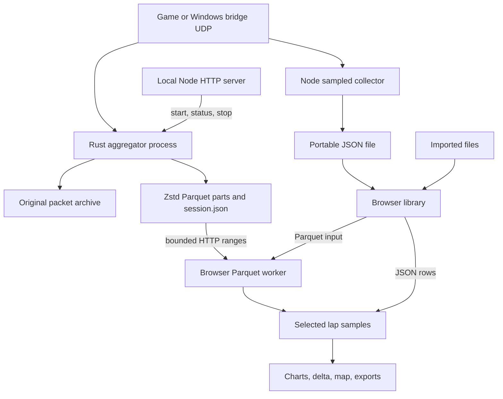

# Architecture

RaceHub separates game capture, file storage, and browser analysis.
Each part can be inspected or used on its own.

[Wiki home](Home.md) | [Modules](Modules.md) | [Data and units](Data-and-Units.md)

## Runtime paths

Choose one recording mode for a session.
The diagram shows alternatives. It does not send the same UDP stream to two processes automatically.

### Native capture

The Rust `aggregator` process owns the UDP socket.
It receives packets, checks the selected protocol, and builds canonical rows.
It writes original packets and Parquet parts to disk.
The Node server starts the process, receives status, and requests a clean stop.
The browser receives a bounded preview while recording continues on disk.
The preview frequency does not set the stored frequency.

### Sampled capture

The Node server owns the UDP socket in this mode.
Its adapters decode supported F1, iRacing, or rFactor 2 data.
F1 parsing uses `@racehub-io/f1-telemetry-client`.
The collector selects samples at the configured rate and writes portable JSON.
Use this path for convenience or F1 formats outside the native F1 24 decoder.
Use the native path when you need source-rate storage.

### File analysis

The browser imports supported JSON or Parquet files.
It stores the library in IndexedDB for that site origin.
Parquet indexing and selected-lap reads run in a worker.
Charts consume the selected rows through a common lap and participant model.
The chart display can reduce plotted points. The original recording stays intact.

## Web application modules

| Module | Responsibility | Source |
| --- | --- | --- |
| Application entry and routes | Local browser routes or Pages hash routes | [Root](../../src/Root.tsx) |
| Panel layout | Move, resize, and save analysis panels | [Canvas](../../src/components/Canvas/Canvas.tsx) |
| Session library | Import, open, rename, compare, export, and remove browser entries | [Explorer](../../src/components/Canvas/Explorer/Explorer.tsx) |
| Local recorder | Choose a source, recording mode, rate, and scope | [Recorder](../../src/components/Canvas/Recorder/Recorder.tsx) |
| Session and lap controls | Select laps and a reference | [Session panel](../../src/components/Canvas/SessionPanel/SessionPanel.tsx) |
| Charts and delta | Render recorded channels, a shared cursor, and distance comparisons | [Analysis functions](../../src/components/Canvas/LineChartPanel/analysis.ts) |
| Track map | Display a path from recorded world coordinates | [Map panel](../../src/components/Canvas/MapPanel/MapPanel.tsx) |
| Portable format | Validate and normalize supported JSON and CSV data | [Data](../../src/telemetry/data.ts) |
| Browser storage | Store sessions, Parquet files, and catalogue entries | [Library](../../src/telemetry/library.ts) |
| Parquet reader | Index parts and load bounded selections | [Parquet](../../src/telemetry/parquet.ts) |
| Worker interface | Run Parquet operations without parsing them on the UI thread | [Worker client](../../src/telemetry/parquetClient.ts) |
| Local service | Serve the application, recorder API, status events, and disk files | [Server](../../server/index.mjs) |
| Simulator adapters | Map source packets to portable measurements | [Adapters](../../server/adapters.mjs) |
| Native process and files | Find the native executable and serve safe part ranges | [Native service](../../server/native.mjs) |
| Sampled disk storage | Save and recover JSON recording files | [Storage](../../server/storage.mjs) |

## Local and hosted builds

| Property | Local build | GitHub Pages build |
| --- | --- | --- |
| Recording controls | Available when the local service runs | Hidden |
| Collector API | Local Node server | None |
| Routes | `/analyser` | `/#/analyser` |
| Parquet input | Imported files or recorder file ranges | Imported files |
| Source and setup links | Repository guide | Deployed source revision |
| Storage | Local recorder disk and browser origin | Browser origin |

The hosted page cannot start a native process or read a local recorder file reference.
Export the original files locally. Then import them into the hosted page.
Pages and local sites have separate browser libraries.

## Extension boundaries

To add a simulator, define its source decoder and documented units.
Preserve participant identity, session identity, source time, and missing channels.
Add actual packet recordings that you have permission to share.
Then verify conversion, storage, import, and lap comparison together.

A new Node F1 format does not update the native Rust decoder automatically.
A bridge channel is unavailable until that bridge sends it.
A decoder cannot recover measurements that the source withheld.
