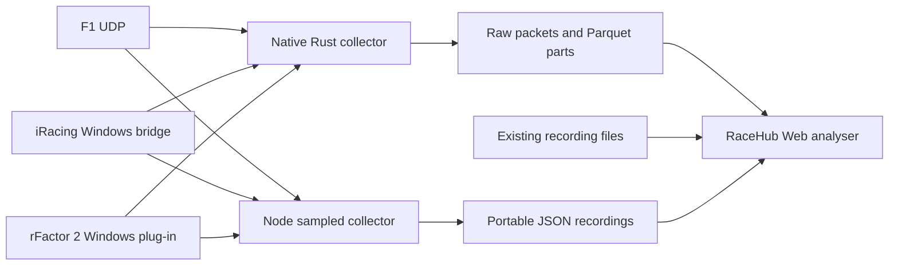

# RaceHub project wiki

RaceHub is a free, open source system for racing telemetry.
It connects game data, local recording, durable files, and lap analysis.
F1, iRacing, and rFactor 2 use the same analysis application.
No RaceHub account, subscription, or hosted data service is required.

Use RaceHub to inspect driving inputs, compare laps, and examine recorded vehicle channels.
Keep your original recordings. Read the measurements and their limits before you draw a conclusion.

## Start here

| Your task | Read |
| --- | --- |
| Install the application or import a recording | [Getting started](Getting-Started.md) |
| Understand each repository and choose a tool | [Modules](Modules.md) |
| Understand the recording and analysis paths | [Architecture](Architecture.md) |
| Record source-rate telemetry and recover files | [Capture and recovery](Capture-and-Recovery.md) |
| Compare laps and inspect a corner | [Analysis workflow](Analysis-Workflow.md) |
| Check units, timing, file types, and missing data | [Data and units](Data-and-Units.md) |
| Assess the tools for professional session review | [Professional analysis](Professional-Analysis.md) |
| Check test evidence and remaining limits | [Validation and limits](Validation-and-Limits.md) |
| Run a private server or change the source | [Self-hosting and development](Self-Hosting-and-Development.md) |
| Solve a setup or import problem | [Troubleshooting](Troubleshooting.md) |

## The complete system

The Rust collector records received packets at their source rate.
The Node collector provides sampled JSON capture.
The browser supports both recording paths through portable files and a common lap model.
The F1 client remains a reusable Node.js packet library.
It is one part of the project.

## Why the design matters

- Keep packet times and original data for later checks.
- Use Parquet to store many channels in compressed parts.
- Read selected laps in a browser worker instead of loading a full recording into charts.
- Compare elapsed time over shared measured distance.
- Inspect speed, pedals, steering, tyres, fuel, and other available numeric channels together.
- Export files for an independent check or a separate analysis tool.
- Inspect and change the capture, conversion, and display code.

These properties support detailed engineering and driver review.
They do not prove a simulator channel's accuracy or replace validation of a test setup.
Read [Professional analysis](Professional-Analysis.md) for the practical use and [Validation and limits](Validation-and-Limits.md) for the evidence.

## Current implementation

The local platform and Pages changes use `telemetry/local-platform` in the Web, Rust, and iRacing repositories.
Use those matching branches until their pull requests merge.
The F1 Node package `@racehub-io/f1-telemetry-client` is published as `0.3.0`.
The native F1 decoder currently supports F1 24.
The Node client supports more F1 formats.

The [GitHub Pages analyser](https://racehub-io.github.io/racehub-web/#/analyser) is the file-analysis entry point after deployment.
It cannot run the game recorder.
The local application can record and analyse telemetry.
Pages becomes available after a signed source push and a successful deployment workflow.
Check the [deployment workflow](https://github.com/racehub-io/racehub-web/actions) for the revision you use.

## Open source and contribution

This wiki is part of the repository at `docs/wiki`.
Its links and changes can be reviewed with the application source.
Start from the [repository README](../../README.md) for command references.

RaceHub dedicates the rights it owns in its source contributions under CC0 1.0 Universal.
Other licences and notices still apply to dependencies, protocols, recordings, and SDKs.
Read [LICENSING.md](../../LICENSING.md) and each module's licence files.
The racing games keep their own purchase, account, and licence requirements.

Read the [contribution guide](../../CONTRIBUTING.md) and [security guide](../../SECURITY.md).
Share recordings only when you have permission.
Keep private recordings and credentials out of public issues.
